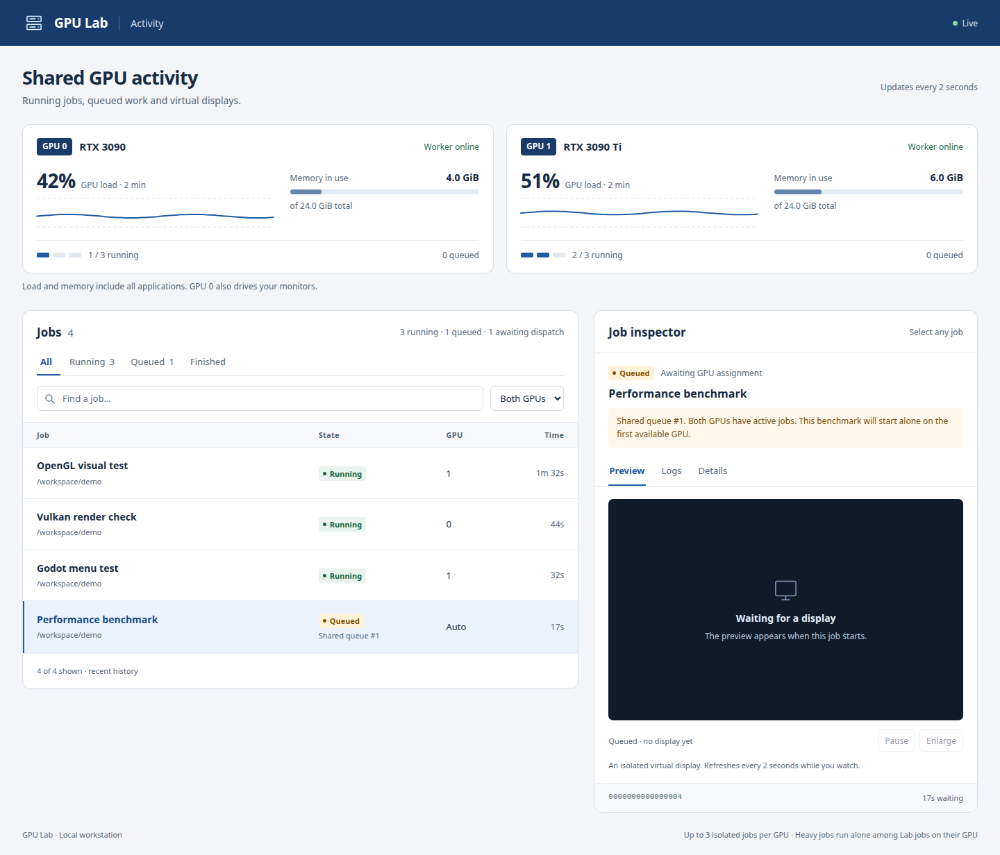

# GPU Lab

Run agents' graphical tests on shared NVIDIA GPUs, each with its own virtual display.

GPU Lab combines a durable job queue, load-aware GPU assignment, a CLI, a stdio MCP server, and a local dashboard. Codex, Claude Code, other MCP clients, and ordinary terminal sessions use the same queue. Workers start at boot; submitting tests needs no sudo.

**Current scope:** one trusted Linux account, two NVIDIA GPUs, up to three simultaneous jobs per GPU. Tested on Ubuntu 24.04 with RTX 3090/3090 Ti and NVIDIA 580. Other platforms and hardware combinations need validation. This is an initial public source release.



*Documentation example using synthetic jobs and GPU readings.*

## What it does

- Chooses a GPU when a queued job can start, preferring an idle GPU before sharing.
- Uses recent utilization, free VRAM, startup reservations, and workload hints to admit work.
- Gives every running job an isolated X11 display, Xauthority, D-Bus session, runtime directory, and process cgroup.
- Supports OpenGL, Vulkan, CUDA, Godot, and Wine/DXVK/VKD3D workloads.
- Provides job-scoped screenshots, window inspection, keyboard/mouse input, logs, timeout, and cancellation.
- Shows load, memory, queue positions, waiting reasons, and selected job previews in a local dashboard.
- Preserves waiting jobs through dispatcher restarts and keeps stable job IDs after GPU assignment.

A running program stays on its assigned GPU. A GPU that also drives physical monitors still shares processing and memory with the desktop. GPU Lab is for cooperative local programs; it is not a security sandbox for untrusted code. See [security and limits](SECURITY.md).

## Install

The first release targets **Linux x86_64 with Debian/Ubuntu NVIDIA paths**, Python 3.10+, systemd 254+, and cgroup v2. It needs an installed NVIDIA driver, its Vulkan ICD, Mesa's Vulkan device-selection layer, and the X11 tools listed in the [installation guide](docs/installation.md).

From a checkout, choose two UUIDs reported by `nvidia-smi -L`. Slot 0 has additional headroom for a desktop GPU. Replace the example UUIDs below with your own:

```sh
nvidia-smi -L

/usr/bin/python3 setup_gpu_lab.py --user "$USER" \
  --gpu0 GPU-00000000-0000-0000-0000-000000000001 \
  --gpu1 GPU-00000000-0000-0000-0000-000000000002
```

The default is a **read-only installation preview**. Add `--check` to check prerequisites. Run the same command with `sudo` and `--apply` to install a fresh system. The installer refuses to overwrite an existing installation or saved job state. See [administration](docs/administration.md) for an existing setup.

After installation:

```sh
gpu-lab status
gpu-lab run --cwd "$PWD" --workload light --timeout 30 -- /usr/bin/xmessage 'Hello from GPU Lab'
gpu-lab-dashboard-open
```

The dashboard is loopback-only at `127.0.0.1:8766`. Its launcher authenticates the browser with a private local token.

## Connect agents

Registration is optional and also previews changes by default:

```sh
python3 register_clients.py --client both --with-instructions
python3 register_clients.py --client both --with-instructions --apply
```

Use `--client claude` or `--client codex` to configure just one client. Run registration as your ordinary user. It preserves existing configuration and creates private backups. Reconnect the clients' MCP servers afterward.

Any stdio MCP client can start:

```sh
/usr/local/bin/gpu-lab mcp
```

The eight tools are `gpu_status`, `gpu_submit`, `gpu_job`, `gpu_logs`, `gpu_cancel`, `gpu_screenshot`, `gpu_windows`, and `gpu_input`. See [client configuration](docs/clients.md), [CLI and MCP usage](docs/usage.md), and [agent guidance](docs/agent-instructions.md).

## Scheduling

Leave `gpu=auto` and `workload=auto` for ordinary tests. `light` is a small UI test hint; `heavy` requests exclusive access among GPU Lab jobs on the assigned GPU. `vram_mb` estimates peak VRAM; it is not a memory quota.

Automatic jobs wait in one shared queue until a GPU can admit them. Before sharing a GPU, the dispatcher allows 20 seconds for the previous job's startup load to settle. Queue order prevents a steady stream of small jobs from starving heavy jobs. GPU-specific requests remain pinned. CPU-only builds and imports normally run outside GPU Lab.

[Architecture and scheduling details](docs/architecture.md) describe the worker boundary, failure recovery, and limits.

## Develop and test

```sh
python3 -m venv .venv
. .venv/bin/activate
python -m pip install -r requirements.txt
make test
make check
```

Unit tests run without a GPU or root. Linux and `dbus-run-session` are needed for process lifecycle tests; Node.js is used only for the dashboard syntax check. CI runs these checks on Python 3.10, 3.12, and 3.13. Live GPU tests are opt-in and use the installed GPU Lab queue:

```sh
python scripts/smoke_test.py
# Optional: OpenGL/Vulkan/CUDA device isolation probe
python scripts/smoke_test.py --probe
```

See [CONTRIBUTING.md](CONTRIBUTING.md) for development, [CHANGELOG.md](CHANGELOG.md) for the release, and [release preparation](docs/releasing.md) for source archives.

## License

[Apache License 2.0](LICENSE). Copyright 2026 GPU Lab contributors. See [NOTICE](NOTICE). NVIDIA drivers, Python, Pillow, Xorg, and other system dependencies keep their own licenses and are not bundled.
