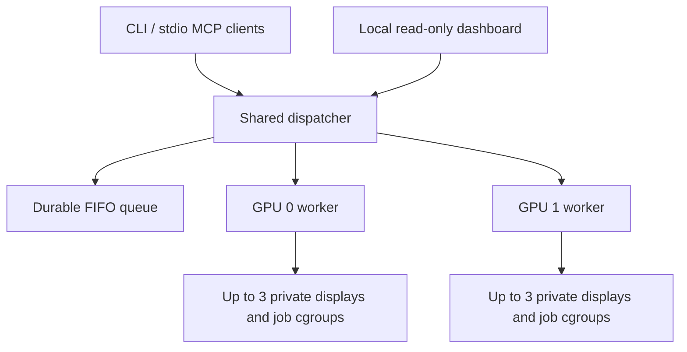

# Architecture and scheduling

`gpu_lab.py` implements the CLI, MCP adapter and worker. `gpu_dispatch.py` owns the persistent shared queue and stable public IDs. `gpu_pool.py` supplies worker routing, telemetry and compatibility with earlier adapters. `gpu_schedule.py` contains admission rules. `dashboard_server.py` serves authenticated read-only monitoring; `dashboard/` is plain HTML/CSS/JavaScript. `prepare.py` resolves device aliases at boot.

## Admission

The dispatcher polls workers and GPU telemetry, then considers waiting jobs in creation order. A pinned wait does not block an unrelated GPU. Automatic jobs stay unassigned until at least one candidate passes admission. Candidates must have a healthy available display, no earlier worker queue, room below the concurrency limit, enough free VRAM, acceptable recent GPU load, and no conflicting heavy job.

A GPU with no Lab jobs is preferred before adding a sibling. Remaining ties use recent peak utilization, active count, memory use, then slot 1. A 20-second settling period after the latest start reduces premature sharing during initialization. Existing workers also enforce their own admission rules, including a five-second launch gap and a recent five-second utilization window. Three fresh samples are required before sharing. Defaults are a 65% admission threshold and 2048 MiB reserve on slot 0, versus 75% and 1024 MiB on slot 1. Startup VRAM estimates are temporarily reserved. Up to three jobs may share a GPU; heavy jobs exclude other Lab jobs there.

Measured utilization is busy time, not guaranteed future capacity. Load can rise after admission. External workloads are measured but not controlled. Running jobs are neither migrated nor terminated just to equalize graphs. A worker can briefly queue an admitted job if capacity changes before it starts.

## Ownership and recovery

Each worker owns its processes, isolated display sessions, cgroups, logs and final job metadata. The dispatcher persists a public record before sending a submission. A private random marker in the worker's saved environment allows reconciliation if a reply is lost. Unknown outcomes are never blindly retried; the target GPU stays reserved until acceptance can be established. That conservative wait is exposed in `waiting_reason`.

The public ID maps to the worker's internal ID. Job, screenshot, input, logs and cancellation use that mapping. Historical worker IDs remain resolvable. The pool's file lock serializes admissions with older direct-routing adapters until those clients reconnect.

Restarting the dispatcher preserves its queued work and reconnects to running worker jobs. Restarting a worker interrupts its running/assigned jobs; records become `interrupted`. Shared jobs that have not been dispatched survive host reboot. Workers never adopt saved PIDs, which could have been reused.

## Process and display handling

Boot preparation resolves each configured UUID to NVIDIA and DRM character devices and creates root-owned aliases. Workers run as the configured ordinary user with systemd device policies. Their Xorg processes use a non-console seat, an explicit PCI device and `UseDisplayDevice None`; display/GPU/session overrides are reserved. CUDA is selected by UUID; Vulkan uses the NVIDIA ICD and Mesa device-selection layer; GLX uses the worker's X server.

Each job receives its own D-Bus session and runtime directory. The child waits until it has been placed in its delegated cgroup before executing the user's program. Completion, timeout and cancellation clean up descendants. A failed virtual display is repaired after its affected job is cleaned up, independently of sibling displays.

Source references: [systemd resource delegation](https://www.freedesktop.org/software/systemd/man/latest/systemd.resource-control.html), [Mesa device-selection variables](https://docs.mesa3d.org/envvars.html#vulkan-mesa-device-select-layer-environment-variables), and [NVIDIA utilization metrics](https://docs.nvidia.com/deploy/nvidia-smi/index.html#utilization).
